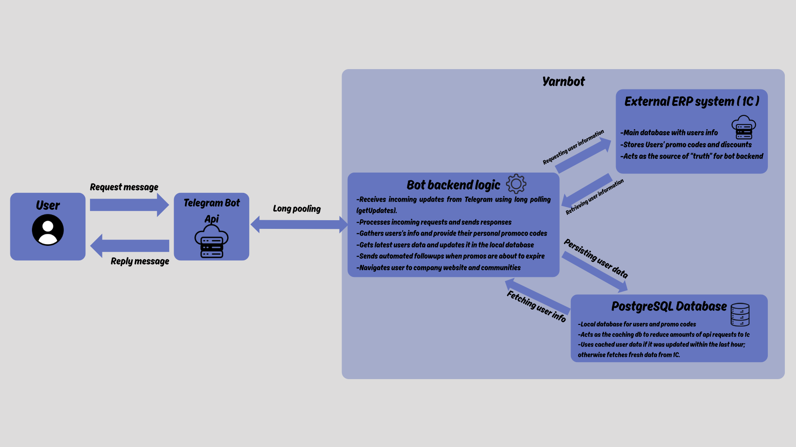

# Yarn-bot

Telegram customer loyality Bot

A simple Telegram Bot designed for customers to track their promo codes and send scheduled notifications through integration with an external ERP system.

## Overview

Yarn-bot is a bot developed to simplify customer interaction with a loyality program.

It communicated with an external ERP system through REST API, retrives customer information and promo codes, stores relevant data in PostgreSQL and sends automated notifications.

## Features

- Customer identification by phone number
- Integration with an external 1C REST API
- Promo codes synchronization
- Automated notifications about expiring promo codes
- Scheduled background tasks
- Admin notifications and error logging
- Database caching to reduce external API requests

## Architecture

